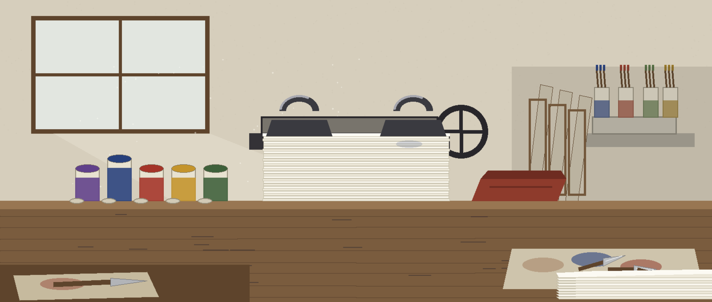
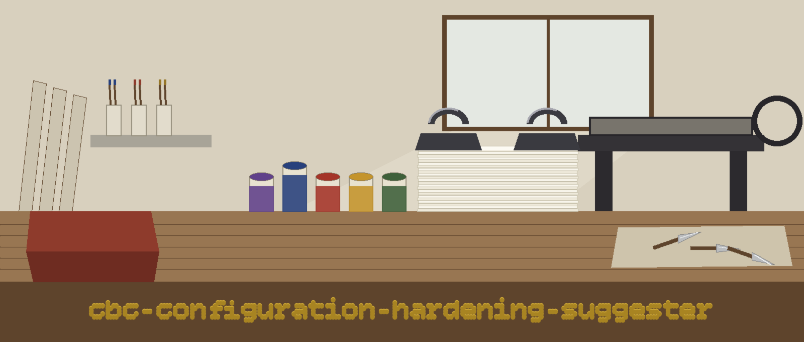
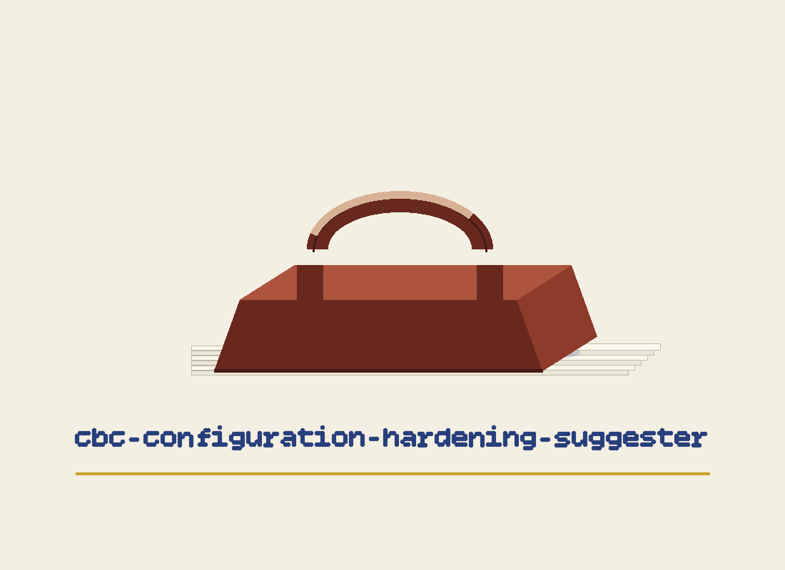

# cbc-configuration-hardening-suggester

# cbc-Configuration-Hardening-Suggester
Validates a system configuration file (YAML) against a security baseline written as a JSON Schema. Every validation failure becomes one report item at the failing property path, carrying the schema error message and, where the baseline carries them at that path, a recommendation and a severity level. Where the baseline carries nothing for a path, the report shows a default note that no specific recommendation is available and a Medium severity. The run exits nonzero when the config fails validation, and prints the no issues line only when the config passes. Uses `pyyaml` for configuration parsing and `jsonschema` for validation.

## Install
`git clone https://github.com/ShadowGuardAI/cbc-configuration-hardening-suggester`

> Jar label: the clone line points at an account spelled differently from this repository's home, ShadowGuardAI without the hyphen, while the repository lives under ShadowGuard-AI.

## Usage
`./cbc-configuration-hardening-suggester [params]`

> Jar label: the usage line names neither the configuration file nor the baseline schema, although those two files are the tool's entire input.

## Parameters
- `-h`: Show help message and exit
- `-v`: Enable verbose logging.

## License
Copyright (c) ShadowGuardAI
